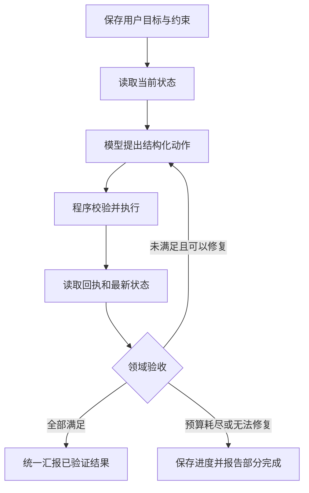

# AI助手专项审查

审查日期：2026-10-19

代码基线：`945b778`

范围：项目内 AI 助手的执行控制、工具接口、结果验收、错误恢复、记忆与评估。

定位：专项审查与改进建议；本文件没有修改运行机制，也不代表下述建议已经实现。

论文与下载情况见 [资料索引](README.md)，工程文档见 [工程实践索引](工程实践索引.md)。

## 1. 核心结论

项目已经具有“模型输出动作 → 执行命令 → 返回结果 → 模型继续”的基本代理循环。原子写入、冲突检测、参数校验、备份及推理文本隔离也是已有的有效基础。

主要缺陷在于：**用户目标、执行动作、实际效果和完成汇报尚未形成统一闭环**。因此会出现“光说不做”“部分执行后宣称完成”“错误后重复原动作”“下一轮继续时忘记已经做了什么”。这些现象不能只靠换模型或加重提示词解决。

模型生成了可信的完成句子，不等于数据已满足用户要求；命令返回 `OK`，也不等于整个请求已经完成。用户要求的每一项必须有对应的可检查证据。

### 1.1 与主流编码代理怎样比较

应分开比较三个层次：

| 层次 | 职责 | 本项目中的对应物 |
|---|---|---|
| 模型 | 理解语言、选择动作、根据反馈调整 | DeepSeek / Anthropic / 兼容端点 |
| 工具与环境 | 查询状态、修改数据、返回执行事实 | `actions.py`、Model、JSON 存储 |
| Harness（运行控制层） | 保存目标、调度动作、管理预算、验收、恢复和结束 | `AIWorker`、循环护栏、历史管理 |

同一模型放入不同工具和控制流程，表现可能不同。不能把某个模型的失败都归因于模型，也不能假定 Codex、Claude Code 等产品不会失败。这里借鉴它们公开的闭环实践，不作缺少同条件测试的品牌排名。

OpenAI 的 [迭代修复示例](https://developers.openai.com/cookbook/examples/codex/build_iterative_repair_loops_with_codex) 将检查、修复、验证组成循环；Anthropic 的 [长任务 harness 实践](https://www.anthropic.com/engineering/effective-harnesses-for-long-running-agents) 也记录了提前宣布完成、测试不充分等问题，并使用明确功能清单、进度记录和实际验证改善行为。这些工程文章不是学术论文，也不是对产品所有执行路径的可靠性保证。

## 2. 当前代码的关键问题

下表区分“代码事实”和“据此提出的设计判断”。实现变化后需复核，不能长期把审查结论当作当前事实。

| 编号 | 已确认的代码事实 | 设计影响 | 优先级 |
|---|---|---|---|
| A1 | 无命令收尾分支直接 emit 并 return，绕过统一 `_finish()` | 已收集的写失败可能没有出现在最终汇报里 | P1 |
| A2 | 以结果字符串 `startswith("OK")` 分类写命令 | 成功、幂等无变化、部分成功、冲突等语义不够明确 | P2 |
| A3 | 用整次请求的 `wrote_data`、成功命令数表示进展，没有逐目标验收账本 | 做了一件事不能证明剩余要求完成，数量也不能代表覆盖率 | P2 |
| A4 | 重复检测按命令文本组合计数，主要返回额外提示 | 模型可以忽略提示，改写参数也可绕过文本重复判断 | P2 |
| A5 | 中间执行结果在 worker 局部 `msgs` 中，服务历史主要追加最终回复 | 下一次“继续/撤销刚才那条”缺少稳定的执行证据与动作身份 | P2 |
| A6 | 历史压缩保留末尾消息，前文只替换为概括性的固定说明 | 原始约束、用户纠正、未完成目标可能丢失 | P2 |
| A7 | 轮次固定为5，总时间在下一轮请求前检查 | 复杂任务可能未完成就停止；单次请求/重试不受剩余总预算严格约束 | P2 |
| A8 | 部分护栏测试调用辅助函数，另有源码字符串守卫 | 能证明函数/提示存在，不能证明实际退出路径经过它们 | P2 |

代码入口：[AIWorker 与 AIService](../../src/services/ai_service.py)、[循环护栏](../../src/services/ai_loop_guards.py)、[动作入口](../../scripts/actions.py)、[数据与校验](../../scripts/actions_core.py)、[现有 worker 测试](../../tests/test_ai_worker_retry.py)。

### 2.1 “光说不做”：结束条件由语言行为触发

`AIWorker.run()` 遇到无命令回复时调用 `_handle_no_instructions()`。当不再续跑时，该方法直接发出 `finished` 或 `finished_with_instructions`，外层随即 return，未将累计失败交给 `_finish()`。

前轮隔离桩复现了两条路径：

1. 命令返回 `ERROR save conflict`，后续模型重复“已记录”，最终只有“已记录”，没有代码侧失败提示。
2. 一条命令也没有发出，连续回复“已记录”；追问次数耗尽后，仍发出正常完成信号。

这说明即使 `_finish()` 的告警逻辑正确，也不足以保护不经过它的路径。

**修改方式**：无命令处理函数只决定继续或停止，不负责最终发送。将正常结束、失败、重试耗尽、预算耗尽及部分执行后的异常统一收口。模型可以申请结束，控制层必须根据目标与证据决定最终状态。

不要简单要求每个请求都产生写操作。纯查询应允许直接返回有依据的结果；目标本来已满足时，验证后的无变化也应视为成功。

### 2.2 “执行了，但没做对”：没有动作后的领域验收

当前工具结果主要回答“这个 handler 返回了什么”，没有充分回答“用户想要的状态现在是否成立”。格式正确、写盘成功、业务意图正确是不同层次。

例如用户说：“把维生素移到抽屉，用掉一片，剩五片时提醒补货。”若初始总余量为24片，至少需要检查：

- 原物品 ID 保持不变，没有通过新增制造重复条目。
- 位置是规范化后的抽屉位置。
- 精确余量是23片，而不是仅展示成0整盒。
- 片级阈值为5。
- 无关字段、其他物品没有被修改。

三条 `OK` 回执不能替代这些检查。验收应读取精确字段与最新版本，而非再次解析可能有展示错误的自然语言摘要。

### 2.3 “错了不会返工”：只有反馈文本，没有恢复契约

将 ERROR 原文回传模型是必要基础，但它没有规定：错误属于什么类型、还能做什么、哪一项目标仍失败、修复后验证什么、何时应停止。

建议定义如下恢复策略：

| 错误类别 | 恢复动作 | 不能做的事 |
|---|---|---|
| 参数不合法 | 根据字段级错误修改参数，重新校验 | 原样重复同一错误调用 |
| 对象不存在/匹配不唯一 | 查询候选对象；无法可靠选择时澄清 | 猜 ID，或擅自新增替代对象 |
| 保存冲突 | 重读最新状态，保留原始意图，重新计算变更 | 关闭冲突检测后覆盖 |
| 结果不确定/响应丢失 | 查询动作回执或实际状态，再决定是否重试 | 直接重复扣减/记账 |
| 写成功但验收失败 | 针对预期与实际的差异修正，再验收 | 仅修改完成文案 |
| 工具缺陷/能力缺失 | 保留已完成进度，明确阻塞和可恢复点 | 无限换措辞重发，或绕过合法数据入口 |
| 预算不足 | 保存账本和回执，报告已完成及未完成项 | 将预算耗尽当作任务完成 |

返工必须受权限、预算和版本约束。代理不应为了完成生活数据任务，临时绕过工具去修改结构化文件或修补应用源码。

### 2.4 “继续”不可靠：聊天记录不等于执行日志

用户说“继续”时，系统应知道哪些目标已验收、哪些动作已生效、哪些需要重试。只有最终的自然语言回复不足以提供这些信息。

建议保存独立的任务与动作记录。聊天可以压缩，但目标、约束、已验证结果、动作身份与未完成原因必须保留。事实记忆与模型反思分开：反思可以提出下次策略，不能覆盖执行事实。

## 3. 建议的最小架构

以下是建议，不是当前项目已有 API。优先在现有分层中接入，不需要先换数据库，也不需要先引入多代理框架。



### 3.1 TaskRun：按用户目标记账

至少记录：

- `request_id`：本次请求身份。
- 原始请求与已解析目标；解析存在歧义时记录不确定性。
- 约束：不可新增重复物品、不可改无关日期等。
- 逐目标状态：pending / running / verified / failed / blocked。
- 已执行动作、验收证据、剩余预算、最后错误。

完成率应按目标计算，不能用成功命令数除以总命令数充当用户需求覆盖率。任务分解本身也可能遗漏要求，需将解析结果与原始请求对照；高风险/歧义场景再要求用户确认，不给简单任务增加固定审批步骤。

### 3.2 ActionReceipt：工具回执结构化

建议字段示例：

```json
{
  "request_id": "request-example",
  "action_id": "action-example",
  "operation": "consume",
  "entity_id": "i_003",
  "status": "applied",
  "changed_fields": ["remaining_doses"],
  "before": {"remaining_doses": 24},
  "after": {"remaining_doses": 23},
  "verification": {"passed": true},
  "error": null
}
```

需要区分 applied、verified_noop、rejected、failed、unknown。回执应来自执行层；模型不能自行填写“验证通过”充当证据。只记录任务所需字段，避免把密钥或私有手机号带入日志和提示词。

工具接口可使用原生 tool calling 或受校验的 JSON 动作协议；CLI 可以继续供人和外部程序使用。当前是从 sh 文本中提取命令、再进行进程内调度，并不等于将任意 shell 文本交给系统执行；改协议的目的主要是减少格式歧义、关联动作与结果，而非声称目前存在任意 shell 执行。

### 3.3 Verifier：领域验收独立于模型自述

优先用确定性规则：库存精确余量、日期范围、对象身份、计划数量、阈值及关联关系。自然语言语义等难以完全机械化的部分，再使用辅助模型评价，并标明不确定性。

新增、移动、扣减、修改提醒应分别有验收器，避免一个“文件发生变化”布尔值覆盖所有业务。验收器本身也要测试，防止错误字段、错误格式化函数与执行器形成共同盲点。

### 3.4 RepairPolicy：有界、分类、可恢复

给每个失败目标分配有限修复机会。每次修复记录错误证据、修改的动作参数、实际结果及新验收结果。重复检测应结合失败类型、对象、参数和状态进展，不能仅比较整批命令字符串。

涉及扣减、记账等不可盲目重复的动作，使用幂等键与版本前置条件。备份是恢复材料，不自动等于安全撤销；撤销还要检查相关对象自执行后是否被其他操作修改。

### 3.5 Reporter：只能基于证据生成状态

建议最终状态明确区分：完成、已满足且无需修改、部分完成、失败、待澄清、被阻塞。

报告内容应由账本和回执约束。例如：“位置已修改；库存已从24片扣到23片；阈值保存因冲突失败，尚未修改。”模型可以组织语言，但不能增添未被证据支持的完成项目。

## 4. 论文与问题的对应关系

### P01 · ReAct: Synergizing Reasoning and Acting in Language Models

- 会议：ICLR 2023；预印本首次提交于2022年。
- [原始页面](https://arxiv.org/abs/2210.03629) · [本地 PDF](papers/01_ReAct_2210.03629.pdf)
- 重点：将推理、行动、环境观察交替组织。
- 对本项目：工具执行后应获得足够的可用反馈，再决定下一步；不要求暴露或执行内部思维链。

### P02 · Reflexion: Language Agents with Verbal Reinforcement Learning

- 会议：NeurIPS 2023。
- [原始页面](https://arxiv.org/abs/2303.11366) · [本地 PDF](papers/02_Reflexion_2303.11366.pdf)
- 重点：把任务反馈形成的反思保存到记忆，影响后续尝试。
- 对本项目：保存“失败原因—证据—下次策略”，避免每次从头犯同样错误。反思不是执行证明，也不保证重试成功。

### P03 · CRITIC: Large Language Models Can Self-Correct with Tool-Interactive Critiquing

- 会议：ICLR 2024；预印本首次提交于2023年。
- [原始页面](https://arxiv.org/abs/2305.11738) · [本地 PDF](papers/03_CRITIC_2305.11738.pdf)
- 重点：使用外部工具反馈支持验证与纠正。
- 对本项目：回读真实数据、识别差异、修正、再次验收；适合指导“错了如何返工”。

### P04 · Large Language Models Cannot Self-Correct Reasoning Yet

- 会议：ICLR 2024；预印本首次提交于2023年。
- [原始页面](https://arxiv.org/abs/2310.01798) · [本地 PDF](papers/04_Self_Correction_Limits_2310.01798.pdf)
- 重点：在所研究的推理任务中，缺少外部反馈的内在自纠错并不可靠，有时会降低表现。
- 对本项目：不能把“请仔细检查”当验收机制。该论文不是“所有模型永远不能纠错”的证明。

### P05 · SWE-agent: Agent-Computer Interfaces Enable Automated Software Engineering

- 会议：NeurIPS 2024。
- [原始页面](https://arxiv.org/abs/2405.15793) · [本地 PDF](papers/05_SWE_agent_2405.15793.pdf)
- 重点：代理与计算机之间的工具、反馈接口设计会影响任务表现。
- 对本项目：优化查询能力、动作协议、错误回执与状态展示，不能只优化系统提示词。

### P06 · τ-bench: A Benchmark for Tool-Agent-User Interaction in Real-World Domains

- 本资料按2024年预印本登记，不额外推断会议信息。
- [原始页面](https://arxiv.org/abs/2406.12045) · [本地 PDF](papers/06_tau_bench_2406.12045.pdf)
- 重点：用户对话、领域工具与规则共同组成任务，按最终数据库状态评估；使用 pass^k 衡量重复试验可靠性。
- 对本项目：最接近生活助手的评估对象。关注多次都完成，而不是只展示一次成功；pass^k 不等同于“多试几次至少成功一次”的 pass@k。

### P07 · Agentless: Demystifying LLM-based Software Engineering Agents

- 本资料按2024年首次预印本登记；后续发表情况以来源页为准。
- [原始页面](https://arxiv.org/abs/2407.01489) · [本地 PDF](papers/07_Agentless_2407.01489.pdf)
- 重点：使用较明确的定位、修复和验证阶段，研究简单流程的能力。
- 对本项目：先实现清楚、可验证的单代理流程，不必为基础闭环引入复杂多代理。

### P08 · Why Do Multi-Agent LLM Systems Fail?

- 本资料按2025年首次预印本登记；MAST 是论文提出的失败分类体系。
- [原始页面](https://arxiv.org/abs/2503.13657) · [本地 PDF](papers/08_MAST_2503.13657.pdf)
- 重点：系统设计、代理间不一致和任务验证等失败类别。
- 对本项目：用于设计检查清单及理解过早终止/验证不足。研究对象是多代理系统，不能把所有分类直接当作本项目单代理的实验证明。

上述论文提供方法和实验依据，不证明本项目会获得论文中的成功率。本次没有复现论文实验，也没有进行不同模型的同条件排名。

## 5. 建议的评估集

| 场景 | 应检查的结果 |
|---|---|
| 模型只说“已记录”而无动作 | 不得汇报修改成功；可修复则续跑，否则明确失败 |
| 三个目标只完成一个 | 已完成项不丢；其余保持未完成 |
| 一条成功、一条参数错误 | 修正失败目标，不重复成功的扣减 |
| 动作已写入但响应丢失 | 查询实际结果后恢复，不重复产生副作用 |
| 用户/其他进程修改同一对象 | 版本冲突可见，重读后重新计算 |
| 目标原本已经满足 | 验证后报告无需修改，不制造无意义写入 |
| 修改位置 | 原对象身份保持，条目数量不增加 |
| 24片扣1片 | 数据、UI、查询和提示词均反映23片 |
| 长请求/大量条目 | 逐项目标覆盖率正确，预算结束不伪装完成 |
| 用户纠正前一条指令 | 更新目标及约束，不把旧意图继续执行 |
| “继续”或跨上下文恢复 | 使用账本和回执继续，避免遗漏或重复 |
| 工具不可用/能力缺失 | 有界尝试并如实报告阻塞 |

同一请求应重复采样，比较目标满足率、错误成功汇报率、返工成功率、重复副作用率、延迟和成本。保留模型、端点、提示词版本、初始沙箱、最终状态与动作日志，才有条件比较 harness 和模型的影响。

## 6. 改进顺序

1. **先堵收尾漏洞**：所有路径统一汇报，完整 worker 轨迹测试断言最终文本与状态。
2. **再补回执与回读验收**：先覆盖库存移动/扣减和计划修改，形成最小垂直链路。
3. **增加任务账本与分类恢复**：实现部分完成、幂等重试、冲突重算和“继续”。
4. **最后完善长期记忆与模型对比**：在相同评估集上测量收益，避免无依据地增加轮次或增加代理。

这份专项审查保留在参考资料目录中，作为2026-10-19基线下的设计评估；项目运作原理仍以 `MD-files/ARCHITECTURE.md` 为权威，新机制落地后再同步该文档。
